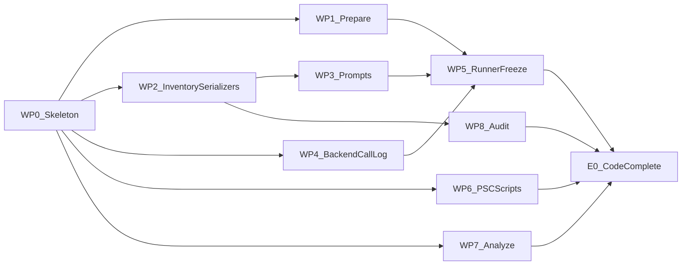

# Shared Qwen3-VL baseline and world state graph experiment

Updated: 2026-10-24 (revision 2). Status: implementation plan; no Qwen3-VL
experiment has been implemented or run under this protocol yet.

This is the current plan from the project discussion. It replaces the earlier
three-category, 96-question proposal and the subsequent proposal to evaluate
graphs on all 810 two-image questions. The existing `idea4_visual_reasoning`
experiment and its GPT-4o results remain a separate study.

How to use this document: Sections 1-7 define the protocol. Section 8 defines
the interfaces that all code must share. Section 9 splits the implementation
into work packages that can be assigned to separate agents. Section 10 is the
execution order with human checkpoints. Section 11 lists decisions that still
need the user's confirmation. An agent assigned a work package should read
Sections 1-8 and its own package; it must not change contracts in Section 8
without updating this file first.

## 1. Objective and agreed scope

Determine when adding an explicit world state helps or hurts multi-image
question answering, and whether organizing the same extracted evidence as a
graph improves on a flat evidence list.

| Component | Default scope |
|---|---|
| Shared raw-Qwen baseline | All 1,000 MMSI-Bench questions, retaining all 2-10 images |
| Graph eligibility | Exactly two images; all 11 official task categories |
| Development | 22 questions: two per category from the existing explore partition |
| Main graph evaluation | 200 automatically sampled questions from the confirm partition |
| Time-constrained evaluation | A predefined, nested 100-question sample |
| Human work | Post-run success/failure analysis; no manual eligibility or graph-authoring gate |
| Default model | `Qwen/Qwen3-VL-8B-Instruct`, one pinned revision and precision |
| Compute | One PSC L40S 48GB or H100 80GB, depending on allocation availability |
| Initial execution | User starts the PSC server and SSH tunnel; experiment runner and outputs are local |

There are no category, static-scene, horizontal-geometry, difficulty, or
expected-benefit exclusions. Measurement, appearance, motion, and the available
two-image multi-step questions (`question_type == "MSR"`) stay in scope. Missing
or uncertain evidence is an experimental outcome, not a reason to remove an
example.

This is a frozen-model inference study. VGGT, judging rounds, diagram feedback,
learned graph models, graph pruning, and human-corrected graphs are deferred.

## 2. Dataset pinning and automatic sampling

Inputs (paths relative to `11777Project/MMML2026/`):

- Dataset: `data/MMSI_Bench.parquet`, SHA-256
  `72a9c94699ca88f3eba79f330ab28965ee537bccd7cbf563265982a6ff8b74b4`.
  The old module's default (`../MMSI-Bench/.analysis/MMSI_Bench.parquet`) is
  not used.
- Split: `analyses/language/splits/language_explore_confirm.json`
  (500 explore / 500 confirm).

Inference preparation reads only the columns `id`, `question_type`, `question`,
and `images`. The `answer` column is read only by the scoring boundary
(Section 6). The `thought` column is never read.

Read-only facts about the pinned artifact, verified 2026-10-24:

- 11 category labels; every question has exactly four options A-D.
- Image counts: 810 with 2 images, 58 with 3, 40 with 4, 19 with 5, 38 with 6,
  15 with 7, 15 with 8, 2 with 9, 3 with 10.
- All 9- and 10-image questions are in confirm (10-image IDs 140, 644, 975).
  Explore's maximum is 8 images.
- 810 eligible (two-image) questions, 405 of them in confirm; 627 connected
  exact-image groups among them; 12 eligible MSR questions, six in confirm.

Preparation must recompute these facts and fail if any differs.

Sampling algorithm (exact; the golden values below were produced by it):

1. Hash every image of all 1,000 questions with
   `idea4_visual_reasoning.data.pixel_hash` (EXIF-transposed RGB pixels plus
   width/height). Build connected question groups over all 1,000 questions
   (union-find through shared hashes, as in
   `idea4_visual_reasoning.data.image_groups`). Group IDs are the smallest
   member question ID. Preserve the original image order.
2. `rng = random.Random(0)`. `category_order = sorted(set(question_type of
   eligible questions))`, then `rng.shuffle(category_order)`. For each category
   in that order, take the confirm eligible candidates sorted by ID and
   `rng.shuffle` them with the same RNG.
3. Round-robin over `category_order`. On a category's turn, `pop()` from the
   end of its list repeatedly until a candidate whose group is not yet occupied
   is found (select it and occupy its group) or the list is empty (the turn
   passes). Skipped candidates are discarded. Stop when 200 are selected or all
   lists are empty. The selection order defines `rank` 1..200.
4. `eval100` = the first 100 by rank; `eval200` = all 200.
5. Development: continuing the same RNG, for each category in `category_order`,
   take explore eligible candidates sorted by ID, `rng.shuffle`, then traverse
   the list in reverse and take the first two whose group is not occupied,
   occupying each group as it is taken. This is category-by-category, not
   round-robin.
6. Timing items (raw only): for each image count `k` in 3..10, take the
   lowest-ID explore question with `k` images whose group is not occupied by
   eval200, development, or earlier timing items. Record `null` where none
   exists.
7. Save IDs, ranks, partition, role, category, image counts, image hashes,
   group IDs, exclusion reasons, actual counts, seed, category order, code
   fingerprint, and dataset/split fingerprints (Section 8.2). Record any
   shortfalls; never backfill based on model outcomes.

ID-list hashes are `hashlib.sha256(json.dumps(ids).encode()).hexdigest()` with
`ids` a Python list of integers in selection order and default `json.dumps`
separators.

Golden values (the `prepare` tests must reproduce all of them):

- `category_order`: `Positional Relationship (Obj.–Obj.)`,
  `Positional Relationship (Obj.–Reg.)`, `Attribute (Meas.)`, `MSR`,
  `Positional Relationship (Cam.–Cam.)`, `Motion (Cam.)`,
  `Positional Relationship (Cam.–Reg.)`, `Motion (Obj.)`, `Attribute (Appr.)`,
  `Positional Relationship (Reg.–Reg.)`, `Positional Relationship (Cam.–Obj.)`.
- eval200 per category: 20 each for Obj.–Obj., Obj.–Reg., Meas., Cam.–Cam.;
  6 for MSR; 19 each for the other six.
  ID-list SHA-256 `efcc9f0272a5653d7d129b9b7851d09fefd3c7cf059d8f5be4283c9a6484e76c`.
- eval100 per category: 10 each for the four categories above, 6 for MSR, and
  9 each for the other six.
  ID-list SHA-256 `2ad8facdfba28f4125071357380002ff533a7f2b3d0f68d8599c87d26e25a25d`.
- Development IDs, in order: 575, 583, 955, 619, 783, 809, 356, 188, 531, 528,
  912, 33, 784, 524, 319, 14, 236, 235, 734, 721, 3, 505.
  ID-list SHA-256 `2e3855ec36382248f883cffddb9b1df3fd52f25f8b357a80b53d620e2394fb92`.
- Timing IDs: 78 (3 images), 13 (4), 72 (5), 75 (6), 77 (7), 223 (8);
  none for 9 or 10.

The alternative reading of step 3 (one pop per turn, ending the turn on a
collision) gives 17-21 per category and is not the protocol.

Because explore has no 9- or 10-image questions, a synthetic 10-image transport
probe (profile `synthetic10`, Section 8.6) is mandatory. Raw latency for 9-10
images is extrapolated from the timing fit (Section 5).

Freeze prompts and processing settings using development only. Then freeze the
active 200- or 100-question profile before the full raw run and graph
evaluation (Section 5). The full raw run includes development and timing items
for team-wide coverage, but graph evaluation and development metrics are
separate. Prior public benchmark and GPT-4o exposure must be disclosed; this is
not an untouched test benchmark.

## 3. Evidence inventory and three conditions

For every evidence-condition item, use one extraction call with the original
images and the question stem. Withhold answer choices during extraction. Create
the flat and graph inputs deterministically from that exact saved inventory.

| Condition | Final-answer inputs | Inference calls per method |
|---|---|---|
| `raw` | Original images, unchanged question/options, answer-format instruction | One answer |
| `flat` | Same inputs plus a flat evidence list | Shared extraction + one answer |
| `graph` | Same inputs plus an entity/relation organization of that evidence | Shared extraction + one answer |

The primary comparison is `graph - flat`. Comparisons against `raw` measure
the complete intervention, including the extra extraction call. They do not
isolate organization or establish that irrelevant information caused any harm.

The inventory format is fixed in Section 8.3 (schema `ws-1`). Requirements:

- Query-frame information; typed camera, object, and region entities;
  view-specific observations; attributed relations and attributes. IDs are
  stable and cross-view identity is explicit. Each claim retains its supporting
  observations and a model-assigned uncertainty (`low`/`medium`/`high`).
  Treat that uncertainty as a model assertion, not a calibrated probability.
- Qualitative spatial relations and short attribute/value records, so
  appearance and measurement questions can be represented.
- Changing observations stay tied to image IDs. Temporal order is recorded
  only when supported by the input; image numbering alone does not establish
  time.
- Image-plane directions are distinguished from camera-relative claims.
  Unknown frames and ambiguous identity are preserved instead of inventing
  geometry.
- Limits: at most eight non-camera entities and 24 relation/attribute claims.
  All references must resolve. An empty inventory with explicit unknowns is
  valid; an invalid schema is a construction failure.
- No metric coordinates, reconstructed camera poses, or bounding boxes. The
  original images remain available at final answering in every condition.
- The flat serializer writes explicit sentences; the graph serializer groups
  typed entities and relations by entity and reference frame (examples in
  Section 8.4). Both render exactly the same set of fact atoms. Neither adds
  inverse or transitive claims, prunes evidence, or calls another model.
- Token length and vocabulary differences are properties of the encoding.
  Report them; do not claim a pure topology effect or equal input-token cost.

## 4. Implementation, PSC setup, and reproducibility

Implement the new Python package `idea4_world_state` in this directory (file
layout in Section 8.1). It may import helpers from `idea4_visual_reasoning`
and `idea3_consistency` but must not modify them or their saved runs. The
following are reused as-is:

- `idea4_visual_reasoning.data`: `pixel_hash`, `images_of`, `image_groups`,
  `sha256_file`, `write_json`, `read_json`.
- `idea4_visual_reasoning.render`: `decode_image`, `normalized_image`
  (EXIF-normalized RGB, resized without cropping, PNG output).
- `idea3_consistency.mmsi_consistency`: `parse_question`, `POST_PROMPT`,
  `extract`.

The following are not reused, because their behavior conflicts with this
protocol:

- `CallLog`: caches failures permanently, and its cache is per run.
- `APIBackend`: requires LiteLLM credentials.
- `stem_of`, `eligibility`, `CATEGORY_MAP`: three-category only.
- `paired_stats`: resamples image groups rather than items within category.

Command interfaces (flags in Section 8.7): `prepare`, `run`, `freeze`,
`analyze`, `audit make`, `audit import`, `audit outcomes`.

Environments:

- Local: the existing `11777-project` Conda environment (pytest 9.1.1,
  openai 3.17.0 present; vLLM not installed and not needed locally).
- PSC: a dedicated environment with a pinned vLLM version that supports
  Qwen3-VL (at least `0.11.0`; the exact pin is chosen in WP6 and recorded in
  the server manifest).

The user supplies the PSC account/allocation and starts the initial server.
Default local endpoint: `http://localhost:8000/v1`. Because compute nodes are
shared, the launcher starts vLLM with a random per-job token passed through
the `VLLM_API_KEY` environment variable. It is never passed as an `--api-key`
argument, which other users on the node could read with `ps`. The server is
ready only when `/v1/models` returns 200 with the token and 401 without it, so
a vLLM that ignored the variable fails at startup instead of serving
unauthenticated. The client reads it from the environment variable named by
`--api-key-env` (default `IDEA4_API_KEY`). No CMU gateway credentials are
required, and tokens never appear in outputs.

Initial settings:

- one GPU, BF16 on L40S/H100, `--max-model-len 32768`, up to ten images per
  prompt
- temperature 0, top_p 1, seed 0
- 4,096 extraction tokens and 64 final-answer tokens
- client-side EXIF-normalized RGB images resized without cropping to maximum
  side 768 px
- 300-second request timeout; concurrency one

Server-side Qwen processor pixel limits stay at their defaults, so the client
resize is the binding constraint. The launcher records the processor
configuration, and development checks that per-image prompt tokens match a
768-px input. Validate all settings on development and freeze any changes
before evaluation. These are controlled experiment settings, not a claim to
reproduce official leaderboard settings.

The launcher writes a server manifest (Section 8.5) recording:

- resolved model/tokenizer revision, precision, and quantization
- processor configuration and full serving arguments
- dependency versions and GPU type

The client verifies the served model name through `/v1/models` and stores the
manifest in each run. A different team checkpoint can be substituted before
development, with the same identity used across every condition; changing it
afterward creates a new run.

Persist full responses, request text, deduplicated image inputs, inventories,
serializations, parsed predictions, statuses, usage, and latency. Store
dataset, selection, prompt, processing, and code fingerprints. Keep
credentials out of outputs. Export raw predictions as JSONL and CSV keyed by
dataset ID (columns in Section 8.8) so teammates can evaluate their own exact
subsets.

Cache terminal results in a shared cache keyed by exact request plus model and
processing identity, independently of subset or run name (Section 8.6). Raw
answers are reused only when inputs, prompt, model, decoding, and concurrency
match. vLLM at temperature 0 is not bitwise deterministic across different
batching, so concurrency is part of the key. Shared baseline values are not
portable across model versions, image resizing, image order, or answer prompts.

Failure semantics (taxonomy in Section 8.6):

- **Transport failures** (connection errors, timeouts, any non-200 HTTP
  status) record the attempt and pause execution: no new requests are issued,
  in-flight requests finish, `status.json` is written, and the process exits
  with code 75. `run --resume` retries only calls whose latest attempt was a
  transport failure and appends to the attempt history. A new server manifest
  can resume that same directory when `created_at`, `host`, and `slurm_job_id`
  are the only manifest differences. The model and tokenizer revisions, dtype,
  quantization, context length, processor limits, seed, vLLM and dependency
  fingerprints, GPU identity, client settings, and the prompt, schema, and
  serializer fingerprints must still match. The first manifest stays in
  `run_config.json`; each later distinct session is appended to
  `server_sessions.jsonl`. An incompatible manifest exits 2 and does not
  change records, attempts, or the session log. Successful and
  terminal calls are reused. There are no hidden SDK retries
  (`max_retries=0`) and no alternate-model fallbacks.
- **Model failures** (malformed or truncated output) are terminal and
  recorded, with no repair model or selective retry.
  - A failed extraction gives both evidence conditions a failed record; the
    raw condition remains independently evaluable.
  - Records still pending a transport retry make reports incomplete.
  - Model failures remain in denominators and count as incorrect.

Support running both server and client in a PSC batch job for unattended runs,
with durable outputs copied back afterward. A batch server plus a local client
still depends on the laptop and tunnel remaining connected.

## 5. Runtime calibration, freeze, and budget decision

Keep the raw run at 1,000 items. With `N` evidence-evaluation items, the
nominal evaluation call count is `1000 + 3*N`: 1,600 for 200, or 1,300 for 100.
Development, timing probes, and interrupted attempts add calls; cached
successes are not charged again in the physical-call count.

Calibration runs, in order:

1. `synthetic10`: one synthetic 10-image raw request. It must succeed with
   prompt tokens at most 30,000 (leaving room for 64 output tokens and
   margin). A real vLLM response with missing, non-numeric, or negative usage
   fails this check. `synthetic: true` only says the images are generated.
   The mock backend is the only missing-usage exemption, and the criterion
   says so. A reported count above 30,000 fails for every backend.
2. `dev` with `raw,flat,graph` at concurrency 1.
3. `timing` with `raw` at concurrency 1.

Measure raw-answer, extraction, flat-answer, and graph-answer latency
separately, together with generated tokens and peak GPU memory (from the
server log or `nvidia-smi`). Fit raw latency as a linear function of image
count over the dev (2-image), timing (3-8 images), and synthetic10 points.
Project raw time by summing the fit over the actual image counts of all 1,000
questions.

Development pass criteria (proposed defaults; confirm in Section 11):

- zero transport failures in the final development pass
- extraction schema-valid on at least 20 of 22 items
- extraction truncation on at most 1 of 22 items
- 100% answer parsing for `raw`, and for `flat`/`graph` wherever extraction
  succeeded
- serializer fact-atom equivalence on every real development inventory
- `synthetic10` passes

Development accuracy is reported but is not a pass criterion. At most three
prompt revisions are allowed on development; each revision gets a new prompt
version file and is recorded in the freeze artifact.

Concurrency test: after a passing sequential development run, repeat `dev`
with `raw,flat,graph` at concurrency 2 into a separate run directory. Select 2
only if end-to-end items per hour are at least 1.15 times the sequential rate,
with zero transport failures and no out-of-memory or preemption messages in
the server log. Do not estimate speedup by dividing sequential time by worker
count.

For sequential operation, estimate seconds as
`T = sum_over_1000(t_raw(n_images)) + N*(t_extract + t_flat + t_graph)`.
Use measured end-to-end throughput for concurrent operation. The planning
allowance is 30% above that projection: `padded = 1.3 * T`. Startup is
reserved inside each job. Usable inference time per job is
`walltime - 0.5 h`. Freeze rejects a wall time that is not greater than
0.5 h, because that job has no time left for inference. When `padded` is
positive, the job count is `ceil(padded / usable)`; otherwise it is zero.
Modeled compute time is `padded + 0.5 h * jobs`. For example, 3.9 h of padded
inference, a 4 h wall limit, and 0.5 h startup require two jobs and 4.9
modeled hours. Queue delay, initial downloads, and human analysis are not
part of modeled compute time and are not added to the deadline comparison.
The 30% allowance is a planning convention, not a statistical confidence
bound.

Budget decision (recorded by `freeze`):

- Human inputs: available allocation (SUs), GPU type, the per-job wall-time
  limit of the chosen partition, and the deadline for completed runs.
- Choose `eval200` if its modeled compute fits within the allocation and the
  modeled finish time is before the deadline. Otherwise choose `eval100` if
  it fits. Otherwise record a scheduling shortfall and stop; do not silently
  cut off examples or choose a sample size from evaluation accuracy. Retain a
  resumable full raw run in every case.

The `freeze` command writes `protocol_freeze.json` (Section 8.6). After it
exists, `run` refuses any `raw_all`, `eval200`, or `eval100` run whose prompts,
schema, serializer code, settings, concurrency, or model identity differ from
the freeze. A new freeze is a new protocol version and is allowed only before
any evaluation-profile `flat`/`graph` call.

Illustrative sequential scenarios discussed in planning, not PSC measurements:

| Assumed mean seconds: raw / extraction / each evidence answer | 200 graph items + full raw | 100 graph items + full raw |
|---|---:|---:|
| 2 / 15 / 3 | 1.72 hours | 1.14 hours |
| 5 / 40 / 6 | 4.28 hours | 2.83 hours |
| 10 / 90 / 12 | 9.11 hours | 5.94 hours |

The PSC guide currently specifies one SU per L40S GPU-hour and two SUs per H100
GPU-hour. Apply these to actual allocated time, including idle time within the
allocation; they are not dollar or per-token prices. Verify the applicable rate
and available allocation balance at launch using PSC's accounting tools.
Source: [Bridges-2 accounting](https://www.psc.edu/resources/bridges-2/user-guide/#accounting-for-bridges-2-use).

## 6. Reporting and post-run case analysis

Scoring boundary: `analyze` is the only code that reads the `answer` column.
A record is correct only if its status is `ok` and `pred` equals the gold
letter; every other status counts as incorrect, and the denominator is always
the full profile size.

Deliverables:

- Full raw accuracy over 1,000 questions, overall and per category, with
  status counts.
- The three conditions on identical active-profile IDs: sample accuracy,
  category macro accuracy (unweighted mean of per-category accuracies), and
  per-category accuracy. The sample is approximately category-balanced and
  restricted by image grouping; do not label its unweighted accuracy as
  estimated accuracy on all 810 two-image questions or all 1,000 questions.
- Paired differences:
  - Primary: `graph - flat`.
  - Exploratory: `flat - raw` and `graph - raw`.
  - Each is computed per item as correct_X minus correct_Y and averaged.
  - Confidence intervals: 2,000 bootstrap resamples (`numpy.random.default_rng(0)`),
    drawing items with replacement within each category at that category's
    original size, then taking the 2.5% and 97.5% percentiles of the mean
    difference.
  - Corrected errors are items where Y is wrong and X is right; introduced
    errors are items where Y is right and X is wrong.
  - Identical predictions or a degenerate interval do not establish
    population equivalence.
- Failures: counts of each record status per condition.
- Evidence coverage per item, reported as distributions and per category:
  - number of non-camera entities, observations, relation claims, and
    attribute claims
  - number of unknowns
  - whether the query frame is known
  - whether any entity is matched across views
  - whether the inventory has at least one claim
- Token counts and latency per call kind. Evidence token overhead is the
  answer-call prompt tokens of `flat` or `graph` minus those of `raw` on the
  same item.
- Costs: unique physical calls and per-method costs. Each evidence method
  includes extraction in its cost; summing method costs would double-count the
  shared physical extraction. Unknown token usage stays null.

Records pending a transport retry block any completed-run claim; the report
header then states `INCOMPLETE` with the missing counts. Output files are listed
in Section 8.8.

State audit (blind):

- `audit make` draws 20 items from the active profile, restricted to items with
  a schema-valid inventory. The number of items excluded for invalid
  inventories is reported.
- The draw uses one `random.Random(0)` stream: the sorted-then-shuffled
  category order, then numerically sorted-then-shuffled IDs per category (in
  that category order), then round-robin `pop()`. It is independent of
  correctness and never reads records.
- The packet must be written to `<run>/audit`. `audit outcomes` looks for
  `imported.json` there.
- The packet shows the images, the question stem, and the extracted state
  rendered as numbered atoms. Answer choices, gold answers, and predictions
  stay hidden.
- Labels per atom:
  - `accuracy`: `supported`, `unsupported`, `contradicted`, or `cannot_judge`
  - `relevance`: `relevant`, `irrelevant`, or `cannot_judge`
- Labels per item:
  - `query_frame_correct`: `yes`, `no`, or `cannot_judge`
  - `identity_error` and `frame_error`: `yes` or `no`
  - `missing_critical_evidence`: `yes` or `no`, plus a note
- Format in Section 8.9. Human review happens after inference and does not gate
  sampling. Never fabricate labels or call an unaudited inventory verified.

Outcome-aware analysis: `audit outcomes` is allowed only after state labels are
imported. It lists the corrected and introduced items for each comparison, with
choices, gold, and predictions. The reviewer assigns one primary error type:

- `inaccurate_or_unsupported_evidence`
- `correct_but_irrelevant_evidence`
- `frame_or_identity_error`
- `reasoning_or_option_mapping_error`
- `other` (with a note)

Case studies suggest explanations; an accuracy drop alone does not prove that
irrelevant information caused the harm.

State the limits:

- automatic screening and public benchmark exposure
- rare two-image multi-step items and small category samples
- a fixed representation budget
- exact-image groups that do not establish independent physical scenes

Corrected human graphs and extension beyond two images are later research
options.

## 7. Cross-cutting test requirements

Each requirement is owned by the work package in brackets (Section 9). All
tests live in `idea4_world_state/tests/`, use synthetic data or the pinned
dataset read-only, and run with
`python -m pytest idea4_world_state/tests -q` in `11777-project`.

- Raw inference preserves all views for 2-, 3-, and 10-image inputs and leaves
  the question/options unchanged. [WP3]
- Selection reproduces every golden value in Section 2, preserves partitions,
  prevents transitive shared-image overlap, and records shortfalls on a
  synthetic dataset where categories run out. [WP1]
- Sentinel examples verify no choices in extraction requests and no gold or
  rationale text in any inference request. [WP3]
- Serializer round-trip tests verify fact-atom equivalence across flat and
  graph for every fixture. [WP2]
- Inventory tests cover:
  - unresolved references and uncertain identity
  - changing observations and unknown frames
  - empty valid states
  - limit violations
  - invalid and truncated JSON [WP2]
- Resume tests verify:
  - successful-call reuse and recorded failed attempts
  - the pause exit code
  - rejection of incompatible raw results
  - configuration changes requiring a new run [WP4, WP5]
- Scoring tests verify paired joins, full denominators, missing records,
  stratified resampling, and physical versus per-method cost accounting. [WP7]
- End-to-end mock results are visibly synthetic (`synthetic: true`, `MOCK` in
  reports) and never presented as model findings. [WP5]
- Rerun `idea4_visual_reasoning/tests` if any imported helper's behavior is in
  question; it must stay green. [all]

## 8. Interface contracts

These contracts are the only coupling between work packages. Changes require
editing this section first.

### 8.1 File layout

```
idea4_world_state/
  IMPLEMENTATION_PLAN.md
  README.md                  # usage; written by WP5
  __init__.py
  __main__.py                # argparse dispatch only (WP0)
  contracts.py               # constants, enums, paths, status names (WP0)
  data.py                    # prepare and sampling (WP1)
  inventory.py               # ws-1 validation and fact atoms (WP2)
  inventory.schema.json      # (WP0, refined by WP2)
  serialize.py               # flat/graph render and parse-back (WP2)
  prompts.py                 # message builders and answer parsing (WP3)
  prompts/                   # versioned prompt text files (WP3)
  backend.py                 # vLLM OpenAI-compatible client and mock (WP4)
  calllog.py                 # shared cache, attempts, pause/resume (WP4)
  runner.py                  # run and freeze (WP5)
  analysis.py                # analyze (WP7)
  audit.py                   # audit make/import/outcomes (WP8)
  psc/                       # launch, tunnel, batch, manifest scripts (WP6)
  tests/
    fixtures/                # example inventories and synthetic data
    conftest.py              # mock HTTP server fixture (WP4)
  artifacts/prepare_v1/      # prepare output (committed, small)
runs/idea4_world_state/
  _cache/                    # shared terminal-result cache (gitignored)
  <run_id>/                  # one run (large parts gitignored)
```

WP0 adds `.gitignore` entries for `runs/idea4_world_state/_cache/`,
`runs/idea4_world_state/*/inputs/`, and `runs/idea4_world_state/*/requests/`.

### 8.2 Prepare outputs (`artifacts/prepare_v1/`)

- `selection.json`. Top-level fields:
  - `version`, `seed`, `dataset_sha256`, `split_sha256`, `code_sha256`
  - `category_order`
  - `facts`: the Section 2 counts
  - `items`
  - `exclusions`: list of `{id, reason}`, where `reason` is `not_two_images`,
    `shared_image_group`, or `not_reached`
  - `shortfalls`: `{category: missing_count}`
  - `profiles`: `{name: {ids, id_list_sha256}}`
  - `manifest_sha256`

  Each entry of `items` has:
  - `id`, `category`, `partition`, `role`
  - `rank` (eval only), `in_eval100`
  - `n_images`, `image_hashes`, `image_group`, `question_sha256`

  `role` is one of `eval`, `dev`, `timing`, or `raw_only`, and `items` covers
  all 1,000 questions.
- Profiles in `selection.json`:
  - `raw_all`: 1,000 IDs in schedule order. That order is eval200 by rank,
    then dev, then timing, then every remaining ID ascending.
  - `eval200`, `eval100`, `dev`, `timing`.
  - `synthetic10` is not a dataset profile; `run` generates it (Section 8.6).
- `inspection/index.html` covers eval200, dev, and timing items. Each entry
  shows ID, role, rank, category, stem, and images; options and gold are
  absent. It is for data-integrity checks only and does not gate anything.
  Images are JPEG thumbnails (maximum side 384 px, made from the
  EXIF-normalized RGB image). The `inspection/` directory is gitignored. Only
  `selection.json` is committed.

As built by WP1 (binding for consumers):

- Hashes:
  - `version` is `"prepare-v1"`.
  - `code_sha256` hashes `data.py` only.
  - `manifest_sha256` is the SHA-256 of canonical JSON of the object without
    that field (`sort_keys=True`, `ensure_ascii=False`,
    `separators=(",", ":")`). It is not a hash of the pretty-printed file
    bytes.
- `items`:
  - Sorted by ID, so it is not the schedule.
  - `image_group` is an integer: the smallest member ID of the component over
    all 1,000 questions.
  - `rank` is null outside eval.
  - `category` is the original `question_type` string.
  - `question_sha256` hashes the full question text.
- Schedule order is `profiles.raw_all.ids`.
- `profiles.timing.ids` holds the six non-null IDs in image-count order.
  `profiles.timing.by_image_count` has string keys `"3"`-`"10"`, with null for
  9 and 10.
- `shortfalls` counts unfilled development slots per category; it is `{}` for
  the pinned run. A shortfall in eval appears as a shorter `eval200` list.
- `exclusions` lists every question whose role is not `eval` or `dev`:
  - `not_two_images` covers every question with more than two images,
    including the timing items.
  - `shared_image_group` means the candidate was visited when its group was
    already taken.
  - `not_reached` means the candidate was never visited.
- Question stems are not in `selection.json`. WP5 reads questions from the
  parquet (inference columns only) and checks `question_sha256` and
  `image_hashes` before building requests.

### 8.3 Inventory schema `ws-1`

The model must return exactly one JSON object. The parser accepts the object
either bare or inside a single fenced code block; any other surrounding text
is `extraction_invalid`.

```json
{
  "schema_version": "ws-1",
  "query_frame": {"frame": "camera:cam2", "basis": "stem asks from the second viewpoint"},
  "temporal_order": {"status": "unknown", "order": null, "basis": null},
  "cameras": [{"id": "cam1", "image_id": "image_1"}, {"id": "cam2", "image_id": "image_2"}],
  "entities": [
    {"id": "e1", "type": "object", "label": "red chair",
     "cross_view": {"status": "same", "uncertainty": "medium"}},
    {"id": "e2", "type": "region", "label": "kitchen doorway", "cross_view": null}
  ],
  "observations": [
    {"id": "o1", "entity": "e1", "image_id": "image_1", "where": "left", "description": "red chair by window"},
    {"id": "o2", "entity": "e1", "image_id": "image_2", "where": "center", "description": "same chair, seen from behind"},
    {"id": "o3", "entity": "e2", "image_id": "image_1", "where": "right", "description": "open doorway"}
  ],
  "identity_links": [],
  "claims": [
    {"id": "c1", "kind": "relation", "subject": "e1", "predicate": "left_of", "object": "e2",
     "value": null, "frame": "image_plane:image_1", "image_id": "image_1",
     "support": ["o1", "o3"], "uncertainty": "low", "note": null},
    {"id": "c2", "kind": "attribute", "subject": "e1", "predicate": "color", "object": null,
     "value": "red", "frame": "unknown", "image_id": null,
     "support": ["o1"], "uncertainty": "low", "note": null}
  ],
  "unknowns": ["whether the doorway is visible in image 2"]
}
```

Field rules:

- `cameras`: exactly one per input image. Camera IDs are `cam1..camN`, and
  `image_id` values are `image_1..image_N` in input order.
- `entities`: at most 8.
  - `id` is `e1..`; `type` is `object` or `region`; `label` is at most 60
    characters.
  - `cross_view` is required (non-null) when the entity has observations in
    two or more images, and must be null otherwise. Its `status` is `same`.
    If the model reuses one entity id across images and leaves `cross_view`
    null, parsing fills `{"status":"same","uncertainty":"medium"}`. That
    shared id is the identity assertion. A `cross_view` object on an entity
    seen in only one image is still invalid.
- `observations`: at most 32.
  - `id` is `o1..`; `entity` is an entity or camera ID.
  - `where` is one of `left`, `center`, `right`, `top`, `bottom`,
    `top_left`, `top_right`, `bottom_left`, `bottom_right`, or `unknown`.
  - `description` is at most 120 characters.
- `identity_links`: at most 8, each
  `{id: "i1..", entities: [eA, eB], status: "tentative"|"different", uncertainty}`.
  This is how two distinct entities that may or may not be the same object
  are represented.
- `claims`: at most 24.
  - `id` is `c1..`.
  - `kind` is `relation` or `attribute`. `subject` and `object` are entity or
    camera IDs. Relations require `object` and null `value`; attributes
    require `value` (at most 60 characters) and null `object`.
  - `support` is a non-empty list of observation IDs.
  - `image_id` rules:
    - A claim with frame `image_plane:image_k` requires `image_id` equal to
      `image_k`.
    - Camera-motion and object-motion relations, and attributes with
      predicate `state`, require a non-null `image_id`: the image in which the
      changed state or later position is observed.
    - Every other claim may use an image ID (the claim is specific to that
      view) or null (the claim is asserted to hold across views).
  - `note` is a string of at most 120 characters, or null. It is required
    (non-null) when `predicate` is `other`.
  - Camera-motion relations require `subject` and `object` to be two
    different camera IDs. Object-motion relations require an entity
    `subject`, and an `object` that is a camera or a different entity.
    Whether the subject camera is actually the later one depends on temporal
    order and is not validated.
  - Frames apply mainly to relations. Attributes whose meaning doesn't depend
    on direction (`color`, `shape`, `material`, `text`, `state`, `count`)
    should use frame `unknown`.
- Relation predicates:
  - Spatial: `left_of`, `right_of`, `in_front_of`, `behind`, `above`,
    `below`, `on`, `inside`, `near`, `far_from`, `adjacent_to`, `facing`.
  - Camera motion (subject is the later camera, object is the reference
    camera): `camera_rotated_left`, `camera_rotated_right`,
    `camera_moved_forward`, `camera_moved_backward`, `camera_moved_left`,
    `camera_moved_right`, `camera_moved_up`, `camera_moved_down`.
  - Object motion (object is the reference camera or entity): `moved_left`,
    `moved_right`, `moved_toward`, `moved_away_from`, `moved_up`,
    `moved_down`.
  - `other`.
- Attribute predicates: `color`, `shape`, `material`, `size`, `count`,
  `length`, `height`, `distance`, `text`, `state`, `other`. Measurement
  values are short strings asserted by the model (for example
  `"about 2 m"`), not coordinates.
- Frames: `image_plane:image_k` (2D left/right/up/down in that picture),
  `camera:camk` (egocentric 3D of that camera), `entity:eN` (allocentric),
  or `unknown`. The same grammar applies to `query_frame.frame`.
- `query_frame.basis` is a string of at most 160 characters, or null, for
  every frame including `unknown`.
- `temporal_order.status` is `supported` (`order` is a permutation of all
  input image IDs and `basis` is a string of at most 160 characters) or
  `unknown` (`order` and `basis` are null).
- `uncertainty` is always `low`, `medium`, or `high`.
- `unknowns`: at most 8 strings of at most 200 characters each. Prompt revision 1 (2026-10-24) raised this from 160 because development item 583's supported unknown was 178 characters and was rejected. The live instruction is `prompts/extract_v3.txt`, kept as the sparse entity/observation baseline. Revision 3, `extract_v4.txt`, added one supported within-image `left_of` example; a six-question check on 2026-10-24 produced zero claims, so v4 is not sent and prompt iteration stops. A repaired `cross_view` uses status `same` and uncertainty `medium`; `medium` is a parser default, recorded per entity in `repairs/<id>.json`, and freeze rejects a run whose `parser_policy` differs from that rule.
- IDs are unique within their list, and every reference resolves.
- Any property not listed in this section makes the inventory schema-invalid
  (`additionalProperties: false` everywhere). The extraction prompt must say
  this explicitly.
- Validation is split in two. `inventory.schema.json` checks structure.
  WP2's semantic validator checks:
  - reference resolution and ID uniqueness
  - one camera per input image
  - the `cross_view` rule
  - the `image_id` rules
  - motion endpoints
  - `note` required for `other`
  - temporal order being a permutation of the input image IDs

  Both must pass; either failure is `extraction_invalid`.
- The empty valid inventory has cameras, `query_frame.frame = "unknown"`,
  unknown temporal order, empty lists, and at least one unknown.

`inventory.atoms(inv)` returns the set of fact atoms (hashable tuples): one
each for the query frame and the temporal order, plus one per camera, entity,
observation, identity link, claim, and unknown. These atoms are the unit of
serializer equivalence and of the audit.

### 8.4 Serializations

Both serializers are deterministic functions of the atoms. Each has a
parse-back function, and the tests require
`parse_flat(render_flat(inv)) == atoms(inv) == parse_graph(render_graph(inv))`.
The examples below correspond to the inventory in 8.3.

Flat:

```
Evidence extracted by a model from the images (may be incomplete or wrong):
Query frame: camera:cam2 (basis: stem asks from the second viewpoint).
Temporal order: unknown.
Camera cam1 took image_1. Camera cam2 took image_2.
[e1] e1 is an object labeled "red chair"; it is the same entity across views (uncertainty medium).
[e2] e2 is a region labeled "kitchen doorway".
[o1] In image_1 (left), e1 is observed: "red chair by window".
[o2] In image_2 (center), e1 is observed: "same chair, seen from behind".
[o3] In image_1 (right), e2 is observed: "open doorway".
[c1] In frame image_plane:image_1, for image_1, e1 is left_of e2. Support: o1, o3. Uncertainty: low.
[c2] Across views, attribute color of e1 is "red". Support: o1. Uncertainty: low.
[u1] Unknown: whether the doorway is visible in image 2.
```

Graph:

```
World state graph extracted by a model from the images (may be incomplete or wrong):
Query frame: camera:cam2 | basis: stem asks from the second viewpoint
Temporal order: unknown
Nodes:
  cam1 [camera] image_1
  cam2 [camera] image_2
  e1 [object] "red chair" | cross-view: same (uncertainty medium)
    o1 @image_1 left: "red chair by window"
    o2 @image_2 center: "same chair, seen from behind"
    c2 color = "red" | across views | support o1 | uncertainty low
  e2 [region] "kitchen doorway"
    o3 @image_1 right: "open doorway"
Identity links: none
Edges by frame:
  image_plane:image_1
    c1 e1 -left_of-> e2 | image_1 | support o1,o3 | uncertainty low
Unknowns:
  u1 whether the doorway is visible in image 2
```

Unknowns are numbered `u1..` by list position. The exact wording of these
templates can change only before the freeze; they are hashed in
`protocol_freeze.json`.

### 8.5 Server manifest (`server_manifest.json`, written on PSC by WP6 scripts)

`server_manifest.json` is a flat JSON object (no nesting) with exactly these
fields. The group labels below are for reading only. Unavailable values are
null, never omitted.

- `created_at`, `host`, `slurm_job_id`
- GPU: `gpu_name`, `gpu_memory_mib`, `driver_version`, `cuda_version`
- Versions: `vllm_version`, `torch_version`, `transformers_version`,
  `python_version`, `pip_freeze_sha256`
- Model: `model_id`, `requested_revision`, `resolved_revision` (a commit SHA
  from `huggingface_hub.model_info`), `tokenizer_revision`,
  `served_model_name`
- Serving: `dtype`, `quantization`, `max_model_len`, `limit_mm_per_prompt`,
  `mm_processor_kwargs`, `seed`
- `serve_command`: the argv list. It contains no key, because the key travels
  in `VLLM_API_KEY`.
- `port`

Types:

- `serve_command` is the only non-scalar field.
- `limit_mm_per_prompt` and `mm_processor_kwargs` are canonical JSON strings
  (for example `{"image":10,"video":0}`) or null. A null
  `mm_processor_kwargs` means the processor defaults at `resolved_revision`.
- `created_at` is UTC `YYYY-MM-DDThh:mm:ssZ`.
- `gpu_memory_mib`, `max_model_len`, `seed`, and `port` are integers.
- `requested_revision` is the ref that was resolved (default `main`).
  `resolved_revision` and `tokenizer_revision` are lowercase commit SHAs.
- `quantization` is null when `--quantization` is not passed.

The server also passes `--limit-mm-per-prompt.image 10`,
`--limit-mm-per-prompt.video 0`, and `--tokenizer-revision` equal to the model
SHA (vLLM 0.32.0 syntax).

The user copies it to the laptop (`psc/fetch_manifest.sh`) and passes it with
`--server-manifest`.

### 8.6 Calls, runs, statuses, and freeze

Call kinds are `raw_answer`, `extract`, `flat_answer`, and `graph_answer`.
Message layout is defined by WP3:

- Every call starts with, for each image: a text part `Image k:` followed by
  the image part.
- `raw_answer`: then the text `question + POST_PROMPT`.
- `extract`: then the text `"Question stem:\n" + stem + "\n" + extraction
  instruction` (the instruction includes the schema).
- `flat_answer`/`graph_answer`: then the serialized evidence as a text part,
  followed by the text `question + POST_PROMPT`.

Cache key: SHA-256 of canonical JSON containing:

- the messages, with image data replaced by the SHA-256 of the exact PNG bytes
  sent
- `kind`, `max_tokens`, `temperature`, `top_p`, `seed` (the decoding seed,
  literal 0), and `concurrency`
- `model_identity`: `served_model_name`, `model_id`, `resolved_revision`,
  `dtype`, `quantization`, `max_model_len`, `vllm_version`, and
  `mm_processor_kwargs`

The key excludes the run ID, profile, endpoint URL, and API key.

Key details:

- `max_side` is not a separate key field. A different resize changes the key
  through the PNG bytes.
- In the hashed form, an image part becomes
  `{"type": "image_url", "sha256": ...}`.
- In `requests/<key>.json`, an image part becomes
  `{"type": "image", "sha256", "path": "inputs/<sha>.png"}`.
- Canonical JSON uses `sort_keys` and compact separators.

`backend.generate` returns `{text, finish_reason, usage: {input_tokens,
output_tokens}, latency_seconds, served_model, response_id}`.

- Only `finish_reason == "length"` is `truncated`. Any other 200 response is
  `ok`.
- A 200 response with no choices is a transport error and is not cached.
- A transport failure during `VLLMBackend(...)` startup raises
  `TransportError`, and WP5 maps it to exit 75.
- A `/v1/models` mismatch or a manifest mismatch raises `ConfigurationError`
  (exit 2).
- The manifest loader requires exactly the 8.5 keys. `serve_command` is a list
  and the rest are scalars or JSON strings.

Shared cache entry (`_cache/<key[:2]>/<key>.json`), written only for terminal
outcomes (`ok` or `truncated`). Fields: `key`, `kind`, `status`, `text`,
`finish_reason`, `input_tokens`, `output_tokens`, `latency_seconds`,
`served_model`, `response_id`, `created_at`, `model_identity`.

Attempt log (`<run>/attempts.jsonl`, append-only), one line per HTTP attempt.
Fields: `key`, `kind`, `attempt`, `started_at`, `latency_seconds`, `outcome`
(`ok`, `truncated`, or `transport_error`), `error_class`, `http_status`, and a
sanitized `message` (no request bodies, no credentials). `error_class`,
`http_status`, and `message` are null on `ok` and `truncated`. A cache hit
makes no attempt, so `attempts.jsonl`, `requests/`, and `inputs/` contain
entries only for HTTP attempts made in that run.

Run directory `runs/idea4_world_state/<run_id>/`:

- `run_config.json` holds:
  - `profile`, `run_id`
  - `ids`: the profile, in schedule order; this is the analysis denominator
  - `items`: `[{id, category, n_images, partition, role}]`
  - `conditions`
  - `settings`: `{extract_tokens, answer_tokens, max_side, timeout, concurrency}`
  - `server_manifest`, `model_identity`
  - `prompt_sha256`: `{raw, extract, flat, graph}`, computed by
    `prompts.prompt_hashes()`. Each value is the SHA-256 of canonical JSON:
    - `raw`: `{"layout": LAYOUT_VERSION, "post_prompt": POST_PROMPT}`
    - `extract`: `{"layout": LAYOUT_VERSION, "instruction": <exact
      extraction instruction text appended after the stem, including the
      embedded schema>}`
    - `flat` and `graph`: `{"layout": LAYOUT_VERSION, "post_prompt":
      POST_PROMPT, "serializer": "flat" | "graph", "serialize_py_sha256":
      <SHA-256 of serialize.py>}`

    `LAYOUT_VERSION` is a string constant in `prompts.py` (initially
    `"ws-layout-1"`). It changes whenever the message layout changes.

    Hashing details:
    - Canonical JSON is `json.dumps(..., sort_keys=True,
      separators=(",", ":"), ensure_ascii=False)`, UTF-8 encoded before
      SHA-256.
    - `serialize_py_sha256` hashes the raw bytes of `serialize.py`.
    - `prompts/extract_v1.txt` contains the placeholder
      `{{INVENTORY_SCHEMA_JSON}}` once. The placeholder is replaced with the
      canonical JSON of the model-facing schema: `inventory.schema.json`
      with the top-level `$schema`, `title`, and `description` removed.
      `prompt_sha256.extract` hashes the expanded text.
    - The freeze file's `prompt_files` entries hash the raw file bytes.
    - `extract_messages` raises `ValueError` unless `parse_question` returns
      exactly four options.
  - `cache_dir`: absolute, or relative to the run directory
  - `dataset_path` (absolute) and `dataset_sha256`, so that `audit` can reload
    images and questions through the inference columns
  - `prepare_manifest_sha256`, `code_sha256`, `freeze_sha256` (or null)
    - `code_sha256` hashes the canonical JSON `{repo-relative path: sha256}`
      over `runner.RUN_CODE_FILES`, which covers every module the run path
      executes. These are the backend, calllog, contracts, data, inventory,
      prompts, runner and serialize modules, plus
      `idea3_consistency/mmsi_consistency.py` and
      `idea4_visual_reasoning/data.py`. Editing any of them changes
      `run_config`, so `--resume` into an existing directory is refused.
  - `server_manifest`: the parsed manifest object, or null for `--mock`
  - `conditions` is a JSON list
  - `synthetic`
  - `inventory_schema_sha256`: SHA-256 of `inventory.schema.json` at run time
  - `serializer_code_sha256`: SHA-256 of `serialize.py` at run time
  - `backend`: `"mock"` or `"vllm"`. This is independent of `synthetic`.

  `synthetic` is true for `--mock` and for the `synthetic10` profile. It marks
  outputs that are not benchmark answers. It does not exempt a missing
  prompt-token count. Only `backend` equal to `"mock"` does, and only when
  usage is missing.

  `server_manifest` is the first server session, or null for `--mock`. Resume
  compares every manifest field except `created_at`, `host`, and
  `slurm_job_id`. Each distinct later session is appended to
  `server_sessions.jsonl` and does not replace the manifest stored in
  `run_config.json`.

  Freeze reads `prompt_sha256`, `inventory_schema_sha256`, and
  `serializer_code_sha256` from the dev, timing, synthetic, and optional
  concurrency runs. Those fingerprints must match each other and the current
  files. A missing fingerprint is not filled in from the current source; the
  error names the profile to rerun into a new output directory. If the current
  prompt, schema, or serializer changed after the runs, the error names the
  profiles to rerun. The freeze file records the dev run's fingerprints only
  after that check.

  The `synthetic10` item id is the string `"synthetic10"`. Its category,
  partition and role are `"synthetic"`. A paused run writes no
  `predictions.jsonl` or `predictions.csv`. Real `raw_all`, `eval200` and
  `eval100` runs require `--freeze PATH` (exit 2 without it). Eval profiles
  also check `active_profile` and `id_list_sha256`. Mock runs enforce a freeze
  only when one is passed.

  Reusing a directory with a different stable config is refused. A new server
  session, limited to `created_at`, `host`, and `slurm_job_id`, is not a
  different config.
- `status.json`: `state` is `running`, `paused`, `complete`, or
  `incomplete`; also counts by status and the pause reason.
- `requests/<key>.json` and `inputs/<sha256>.png` hold request text with image
  references and the deduplicated image inputs.
- `inventories/<id>.json` holds the parsed inventory, or
  `inventories/<id>.error.json` with the raw text and the validation error.
- `serializations/<id>.flat.txt` and `<id>.graph.txt`.
- `records/<id>__<condition>.json`. Fields:
  - `id`, `category`, `n_images`, `partition`, `role`, `condition`
  - `status`, `pred`, `parse_rule` (index of the `extract` pattern that
    matched, or null)
  - `call_keys`: an object mapping call kind to cache key, for example
    `{"extract": "<key>", "flat_answer": "<key>"}`. `flat` and `graph` on the
    same item share one `extract` key.
  - `inventory_sha256`, `serialization_sha256`
  - `input_tokens`, `output_tokens`, `latency_seconds`
  - `synthetic`, `run_id`
- `predictions.jsonl` and `predictions.csv` (Section 8.8).

Record statuses:

- `ok`
- `answer_parse_error`, `answer_truncated`
- `extraction_invalid`, `extraction_truncated` (both apply to `flat` and
  `graph`)
- `input_error`: the runner could not build the request (for example, an image
  failed to decode or a required input file was missing), so no HTTP call was
  made. Terminal; expected count is zero.
- `pending_transport`: non-terminal; makes the run `incomplete`

Exit codes: 0 complete, 75 paused on a transport failure, 2 configuration or
contract violation.

Answer parsing: reuse `idea3_consistency.mmsi_consistency.extract` unchanged
for comparability with the team baseline, and record which pattern matched.
Reports also show accuracy under strict parsing (patterns 0-1 only) as a
sensitivity check.

`synthetic10` profile: ten deterministic 768x768 synthetic PNGs (solid
colors, each with its index drawn), one fixed four-option question, and the
`raw` condition only. It is marked `synthetic: true` and excluded from all
analysis.

`protocol_freeze.json` fields:

- `protocol_version`, `frozen_at`, `frozen_by`
- `prompt_files` (`{path: sha256}`), `inventory_schema_sha256`,
  `serializer_code_sha256`
- `settings`: tokens, `max_side`, timeout, concurrency
- `model_identity`, `server_manifest_sha256`
- `active_profile` and its `id_list_sha256`
- `dev_run_ids`, `timing_run_ids`, `pass_criteria_results`, `timing_summary`
- `budget_inputs`, `projection_hours`, `decision`, `rationale`
- `prompt_revision_history`
- `prompt_sha256`: the `prompts.prompt_hashes()` object that `run` compares
  against
- `pass_criteria`: the constants that were applied, namely 20/22 schema-valid,
  at most 1/22 truncated, 100% answer parsing, speedup 1.15, allowance 1.3,
  and 0.5 h startup per job

Freeze computations, as built by WP5:

- Dev transport criterion: any `transport_error` line in the dev
  `attempts.jsonl` fails, even if a later `--resume` succeeded. After a
  transient failure, re-run `dev` into a fresh directory. Cache hits keep
  their originally measured latency, so the timing inputs are unaffected.
- Raw-latency fit: the mean latency at each `n_images`, then ordinary least
  squares. `t_raw(n)` is clipped at 0.
- Concurrency: compares summed per-call latency of the sequential dev run
  with the attempt wall span of the concurrency-2 run. The out-of-memory and
  preemption check in the server log stays a human confirmation.
- Usable inference time per job is `walltime_hours - 0.5`. Freeze rejects a
  wall time that is not greater than 0.5 h. Job count is
  `ceil(padded_hours / usable_hours)` when `padded_hours = 1.3 * projection_hours`
  is positive, and zero otherwise. Startup hours are `0.5 * jobs`. Modeled
  hours are `padded_hours + startup_hours`. Queue delay is not included. The
  deadline is compared at 23:59:59 UTC against modeled hours only.

### 8.7 Command-line interface

```
python -m idea4_world_state prepare --dataset data/MMSI_Bench.parquet \
    --split analyses/language/splits/language_explore_confirm.json \
    --out idea4_world_state/artifacts/prepare_v1
python -m idea4_world_state run --prepare-dir idea4_world_state/artifacts/prepare_v1 \
    --profile {raw_all,eval200,eval100,dev,timing,synthetic10} \
    --conditions {raw|flat,graph|raw,flat,graph} \
    --endpoint http://localhost:8000/v1 --served-model qwen3-vl-8b \
    --server-manifest PATH --api-key-env IDEA4_API_KEY \
    --out runs/idea4_world_state/RUN_ID --cache runs/idea4_world_state/_cache \
    --extract-tokens 4096 --answer-tokens 64 --max-side 768 --timeout 300 \
    --concurrency 1 [--freeze PATH] [--resume] [--mock]
python -m idea4_world_state freeze --dev-run DIR --timing-run DIR --synthetic-run DIR \
    [--concurrency-run DIR] --allocation-su X --gpu {l40s,h100} --walltime-hours W \
    --deadline YYYY-MM-DD --out idea4_world_state/artifacts/protocol_freeze.json
python -m idea4_world_state analyze --run DIR [--raw-run DIR] \
    --dataset data/MMSI_Bench.parquet --out DIR/analysis
python -m idea4_world_state audit make --run DIR --n 20 --out DIR/audit
python -m idea4_world_state audit import --packet DIR/audit --labels FILE
python -m idea4_world_state audit outcomes --run DIR --analysis DIR/analysis --out DIR/audit_outcomes
```

Flags shown with a value above are defaults: `--dataset`, `--split`,
`--endpoint`, `--served-model`, `--api-key-env`, `--cache`, the token limits,
`--max-side`, `--timeout`, `--concurrency`, and `audit make --n`. The other
flags are required: `--profile`, `--conditions`, and every `PATH`, `DIR`,
`RUN_ID`, `FILE`, and `--out` argument. `--conditions` accepts exactly the
strings `raw`, `flat,graph`, and `raw,flat,graph`. `--deadline` is parsed as
text and validated as `YYYY-MM-DD` by WP5. The Hugging Face model ID
`Qwen/Qwen3-VL-8B-Instruct` is `contracts.DEFAULT_MODEL_ID`; the served name
is `qwen3-vl-8b`.

`--mock` uses the WP4 mock backend; all outputs are then `synthetic: true`.
`analyze --raw-run` joins raw records from the full raw run. It exits 2 unless
all of these hold:

- The raw run's `ids` cover the evidence profile.
- Its `conditions` include `raw`.
- Its `synthetic` flag matches the evidence run's.
- Its `run_config.json` matches the evidence run's `model_identity`,
  `settings.max_side`, `settings.concurrency`, and `prompt_sha256.raw`.
- Every joined raw record's `raw_answer` cache entry has a `model_identity`
  equal to the evidence run's.

The run configuration can't change once a directory exists, which is what
makes the config-level comparison sufficient. Cache entries keep the 8.6
fields only. A covered ID with no raw record is `INCOMPLETE`, not exit 2.

### 8.8 Exports and analysis outputs

`predictions.csv` and `predictions.jsonl` columns:

- `id`, `category`, `n_images`, `partition`, `role`, `condition`
- `pred`, `status`, `parse_rule`, `request_key`
- `served_model`, `model_revision`, `max_side`, `answer_prompt_sha256`
- `input_tokens`, `output_tokens`, `latency_seconds`
- `run_id`, `synthetic`

Gold answers are not included.

`analysis/` contains:

- `summary.json`: completeness, header flags, and all headline numbers
- `accuracy_by_condition.csv`: `condition, n, correct, accuracy, macro_accuracy`
- `accuracy_by_category.csv`: `condition, category, n, correct, accuracy`
- `paired_differences.csv`:
  `comparison, role(primary|exploratory), n, diff, ci_low, ci_high, corrected, introduced`.
  `comparison` is exactly `graph-flat` (role `primary`), `flat-raw`, or
  `graph-raw` (both `exploratory`), meaning X minus Y. The same tokens are used
  in `outcomes.csv`.
- `failures.csv`: `condition, status, count`
- `item_outcomes.csv`: `id, category, condition, status, pred, gold,
  correct`, with one row per profile item and condition (missing records
  have status `missing`). This is the only file outside `analysis.py` that
  carries gold answers. `audit outcomes` reads gold from it and never from
  the parquet.
- `coverage.csv` columns: `id, category, n_entities, n_observations,
  n_relation_claims, n_attribute_claims, n_unknowns, query_frame_known,
  cross_view_matched, has_claim`.
  - The cells are blank when the item has no inventory.
  - `cross_view_matched` means some entity's `cross_view.status` is `same`;
    identity links don't count.
- `costs.csv` columns: `accounting(physical|method), name, n_calls,
  input_tokens, output_tokens, latency_seconds`.
  - Physical rows count unique cache keys, grouped by kind.
  - Method rows are `raw`, `flat`, and `graph`.
  - If any token count in a group is null, that group's total is null.
  - All values come from cache entries.
- Strict-parse accuracy and evidence token overhead are reported in
  `summary.json` and `report.md`.
- The bootstrap visits categories in sorted order using
  `Generator.choice(replace=True)` and `np.percentile(..., method="linear")`.
  Each comparison starts a fresh `default_rng(0)`.
- `report.md`: human-readable tables with the limits text

For the full raw run, the same files are produced with only `raw`.

### 8.9 Audit packet and labels

`audit make` writes:

- `index.html`: images, stem, and atoms numbered `A1..` per item
- `items.csv`: `item_id, category, inventory_sha256`
- `atom_labels.csv`: `item_id, atom_id, atom_text, accuracy, relevance,
  reviewer, notes`; the label columns are empty
- `item_labels.csv`: `item_id, query_frame_correct, identity_error,
  frame_error, missing_critical_evidence, reviewer, notes`; the label columns
  are empty

`audit import` rejects the files if:

- any row is missing or duplicated
- any label value is outside its enum
- a reviewer field is empty
- an inventory hash does not match

`audit outcomes` writes `outcomes.csv` with columns
`comparison, item_id, x_pred, y_pred, gold, direction(corrected|introduced),
primary_error_type, reviewer, notes`.

## 9. Work packages

Shared-file rule for the parallel phase: `contracts.py` may be edited only by
WP2 (inventory constants) and WP7 (appending
`COMPARISONS = ("graph-flat", "flat-raw", "graph-raw")` and
`PRIMARY_COMPARISON = "graph-flat"`). `__main__.py` is frozen; packages
implement the existing `cli_*` functions.

Global rules for every package:

- Do not modify `idea4_visual_reasoning/`, `idea3_consistency/`, or existing
  runs.
- Do not read the `answer` or `thought` columns outside `analysis.py`.
- Never run a real model as part of tests.
- Each package is done when its acceptance checks pass and its tests are in
  `idea4_world_state/tests/`.



After WP0, packages WP1, WP2, WP4, WP6, and WP7 can run in parallel. WP3 and
WP8 start after WP2, and WP5 integrates WP1, WP3, and WP4.

**WP0: Package skeleton and contract constants**
- Goal: give every other package a stable place to plug in.
- Owns: `__init__.py`, `__main__.py`, `contracts.py`, the initial
  `inventory.schema.json`, `tests/fixtures/` (inventory examples),
  `.gitignore` entries.
- Outputs:
  - argparse dispatch for every Section 8.7 command, each calling a stub that
    exits with code 2 and the message "not implemented"
  - `contracts.py` with paths, call kinds, record statuses, exit codes, enums
    from 8.3, and the limits
  - JSON Schema for `ws-1`
  - fixtures: `valid_full.json` (the 8.3 example), `valid_empty.json`,
    `valid_tentative_identity.json`, `valid_changing_observation.json`,
    `valid_unknown_frame.json`, `invalid_unresolved_ref.json`,
    `invalid_over_limit.json`, `invalid_truncated.txt`
- Acceptance:
  - `python -m idea4_world_state --help` lists all commands.
  - Fixture results match `tests/fixtures/expectations.json`: every `valid_*`
    fixture passes `jsonschema` validation; `invalid_over_limit.json` fails
    the schema; `invalid_unresolved_ref.json` passes the schema but is
    semantically invalid (checked in WP2); `invalid_truncated.txt` fails JSON
    parsing.
  - pytest is green.

**WP1: `prepare` and sampling**
- Depends on WP0. Owns `data.py` and `tests/test_prepare.py`.
- Inputs: dataset, split.
- Outputs: `artifacts/prepare_v1/` per 8.2.
- Acceptance:
  - It reproduces every Section 2 fact and golden value.
  - Two runs into different directories give byte-identical `selection.json`.
  - A test proves that only the four allowed parquet columns are read (wrap
    `pq.ParquetFile.iter_batches` and assert on `columns`).
  - No two selected eval, dev, or timing items share a group.
  - On a synthetic dataset with a scarce category, shortfalls are recorded
    with no backfill.
  - It refuses to overwrite a non-empty output directory.

**WP2: Inventory validation and serializers**
- Depends on WP0. Owns `inventory.py`, `serialize.py`,
  `tests/test_inventory.py`, and `tests/test_serialize.py`. After WP0, WP2 is
  the only package that may edit `inventory.schema.json`, `tests/fixtures/`,
  and the inventory-related constants in `contracts.py` (keeping
  `test_skeleton.py` green).
- Required follow-ups from the WP0 review:
  - Add `note` (120) and both `basis` fields (160) to `MAX_LENGTHS` and the
    schema.
  - Change the two `state` claims in `valid_changing_observation.json` to
    frame `unknown`, keeping their `image_id` values.
  - Add one invalid fixture per semantic rule in 8.3, each with an
    `expectations.json` entry:
    - `invalid_image_plane_mismatch.json`: frame `image_plane:image_1` with
      `image_id: image_2`
    - `invalid_motion_endpoints.json`: a camera-motion relation with an
      entity endpoint
    - `invalid_state_without_image.json`
    - `invalid_cross_view_missing.json`
    - `invalid_other_without_note.json`
    - `invalid_temporal_not_permutation.json`
    - `invalid_duplicate_id.json`
    - `invalid_camera_count.json`
- Outputs:
  - `parse_inventory(text, n_images) -> inv`, raising `InventoryError` with a
    reason. It accepts a bare JSON object or a single fenced block, then runs
    the schema check, then the semantic check.
  - `atoms(inv)`
  - `render_flat`, `render_graph`, `parse_flat`, `parse_graph`
- Acceptance:
  - Every fixture validates or fails exactly as recorded in
    `expectations.json`, with a reason naming the violated rule.
  - The round-trip equality in 8.4 holds for every valid fixture plus 200
    randomly generated valid inventories (seeded).
  - Renderings of the 8.3 example match the 8.4 texts exactly.
  - Serializers add no atoms (no inverse or transitive claims).

**WP3: Prompts and message builders**
- Depends on WP2. Owns `prompts.py`, `prompts/extract_v1.txt`, and
  `tests/test_prompts.py`.
- Outputs:
  - `raw_messages`, `extract_messages`, `flat_messages`, and `graph_messages`,
    following the 8.6 layout
  - `parse_answer(text) -> (pred, parse_rule)`
  - `prompt_hashes()`
- The extraction instruction must state:
  - the schema and its limits
  - no answer choice, and no prose outside the JSON
  - that image order is not time
  - the frame grammar
  - unknowns instead of guesses
- Acceptance:
  - Sentinel tests: options text and a planted gold/rationale string never
    appear in any extraction request, and gold/rationale never appear in any
    request.
  - The question text is byte-identical in the raw, flat, and graph answer
    messages.
  - Image count and order are preserved for 2, 3, and 10 images.
  - `parse_answer` agrees with `extract` on a table of cases and reports the
    pattern index.

**WP4: Backend, call log, and resume**
- Depends on WP0. Owns `backend.py`, `calllog.py`, `tests/conftest.py`, and
  `tests/test_calllog.py`.
- Outputs:
  - `VLLMBackend`: OpenAI client with `max_retries=0`; key from an
    environment variable; `/v1/models` check against `served_model_name` and
    the server manifest.
  - `MockBackend`: synthetic and deterministic.
  - `CallLog`: the 8.6 cache key, shared cache, attempts log, pause signalling,
    and resume.
  - A stdlib HTTP mock server fixture with scripted responses (ok, length,
    HTTP 500, connection drop, timeout).
- Acceptance:
  - A transport failure is logged and raises a pause signal that maps to exit
    75.
  - A resumed call is retried once and its attempt history is kept.
  - `ok` and `truncated` results are cached and reused across run
    directories.
  - Failures are never cached.
  - A changed model identity, `max_side`, or concurrency yields a different
    key.
  - No credential string appears in any written file (grep test).

**WP5: Runner, freeze, and exports**
- Depends on WP1, WP3, and WP4. Owns `runner.py`, `README.md`,
  `tests/test_runner.py`, and `tests/test_e2e_mock.py`.
- Outputs:
  - `run` for all profiles and conditions, in `raw_all` schedule order
  - extraction shared by flat and graph
  - failed-extraction fan-out
  - `synthetic10` generation
  - `status.json`
  - exports per 8.8
  - `freeze`: computes the pass criteria, timing fit, projection, and
    decision; writes `protocol_freeze.json`
  - freeze enforcement for `raw_all`, `eval200`, and `eval100`
- Acceptance:
  - An end-to-end mock run through `dev` and `eval100` produces every 8.6 file
    with `synthetic: true`.
  - Killing the mock server mid-run pauses with exit 75, and `--resume`
    completes.
  - A mismatched `run_config.json` is refused with exit 2.
  - An evaluation-profile run with a modified prompt file is refused under a
    freeze.
  - `freeze` on mock runs writes all 8.6 fields and picks `eval100` when the
    budget inputs are too small for 200.

**WP6: PSC scripts**
- Depends on WP0 (manifest format). Owns `psc/`.
- Outputs:
  - `psc/env_setup.sh`: creates the PSC environment with pinned vLLM and
    records `pip freeze`.
  - `psc/serve.sbatch` and `psc/serve_interactive.sh` start
    `vllm serve Qwen/Qwen3-VL-8B-Instruct` with:
    - `--revision <resolved sha>` and `--served-model-name qwen3-vl-8b`
    - `--dtype bfloat16` and `--max-model-len 32768`
    - an image limit of 10 (the version-correct `--limit-mm-per-prompt` syntax)
    - `--seed 0`, `--host 0.0.0.0`, `--port 8000`, and the token in the
      `VLLM_API_KEY` environment variable (never `--api-key` on argv)
  - `psc/write_manifest.py`
  - `psc/tunnel.sh`:
    `ssh -N -L 8000:<compute-node>:8000 <user>@bridges2.psc.edu`
  - `psc/fetch_manifest.sh`
  - `psc/batch_all.sbatch`: server and client in one job, copying outputs to
    `$PROJECT`
  - `psc/README.md`, giving partition and `--gpus` strings for L40S and H100,
    to be verified with `sinfo` on the user's account
- Acceptance:
  - `bash -n` and `shellcheck` are clean locally, and `write_manifest.py` has
    a unit test with mocked system calls.
  - The real check happens in E1 (user-run).

**WP7: Analysis**
- Depends on WP0 (record schema). Owns `analysis.py` and
  `tests/test_analysis.py`; it can develop on synthetic records before WP5
  exists.
- Outputs: every file in 8.8 `analysis/`; the Section 6 definitions; the
  stratified bootstrap; strict-parse sensitivity; the `INCOMPLETE` header.
- Acceptance:
  - On hand-built records with known answers, accuracy, macro accuracy,
    corrected/introduced counts, and costs match expected values.
  - Failures count as incorrect with full denominators.
  - A missing record flips the report to `INCOMPLETE`.
  - Each bootstrap resample keeps per-category sizes.
  - Per-method costs include extraction once per method, while the physical
    call count includes it once in total.
  - A raw run with a mismatched identity is rejected.

**WP8: Audit**
- Depends on WP2. Owns `audit.py` and `tests/test_audit.py`.
- Outputs: `audit make`, `audit import`, and `audit outcomes` per Section 6
  and 8.9.
- Acceptance:
  - The packet HTML and CSVs contain no options, gold, or predictions
    (sentinel test).
  - The draw is deterministic and independent of record correctness.
  - Import rejects missing, duplicate, out-of-enum, and reviewer-less rows.
  - `outcomes` refuses to run before labels are imported.
  - No label is ever pre-filled.

## 10. Execution phases and human checkpoints

- **E0 Code complete** (agent): all packages merged; full pytest green;
  `idea4_visual_reasoning/tests` green; mock end-to-end `dev` run reviewed.
  Then run `prepare` for real and confirm the golden values. Gate: user
  review of the README and the inspection packet.
- **E1 PSC bring-up** (user, agent assists):
  1. Run `psc/env_setup.sh` and start the server.
  2. Open the tunnel and fetch the server manifest.
  3. Run `run --profile synthetic10`.
  Gate: synthetic10 passes and the model identity matches the manifest.
- **E2 Development, timing, and freeze** (agent, user inputs):
  1. Run `dev` with `raw,flat,graph`, revising prompts at most three times.
  2. Run `timing` with `raw`.
  3. Optionally run the concurrency-2 `dev` test.
  4. The user provides the allocation SUs, GPU type, wall-time limit, and
     deadline, and the agent runs `freeze`.
  Gate: the pass criteria are met and `protocol_freeze.json` is reviewed by
  the user.
- **E3 Full raw baseline** (agent): `run --profile raw_all --conditions raw
  --freeze ...`, which schedules eval200 first. Resume after any pause.
  Gate: `status.json` is `complete` with 1,000 raw records; the team export is
  shared.
- **E4 Evidence conditions** (agent): `run --profile <active>
  --conditions flat,graph --freeze ...`. Gate: `complete`.
- **E5 Reports and human analysis**:
  1. `analyze` on the full raw run and on the paired run.
  2. `audit make`, then human labeling (user/team), then `audit import`.
  3. `audit outcomes`, then human error typing.
  4. Write-up using only the imported labels.

The final handoff includes:

- reproducible launch commands and immutable run manifests
- `protocol_freeze.json` and the raw baseline export
- paired tables, cost accounting, and case-analysis materials
- explicit completion and failure counts

A successful implementation does not require the graph to improve accuracy;
it requires a valid, interpretable test.

## 11. Open decisions (proposed defaults; confirm before the listed phase)

1. Development pass thresholds in Section 5 (20/22 schema-valid, at most 1/22
   truncated, 100% answer parsing). Confirm before E2.
2. Answer parsing: reuse the lenient `extract` as primary, with strict parsing
   as a sensitivity check (default), or make strict primary. Confirm before
   WP3.
3. Concurrency selection threshold of 1.15x throughput. Confirm before E2.
4. Budget inputs: allocation SUs, GPU type, wall-time limit, and run deadline.
   Required at E2.
5. Who labels the 20-item audit, and whether a second reviewer labels a
   subset. Required at E5.
6. PSC partition and `--gpus` strings, verified on the user's account during
   E1.
7. Startup allowance of 0.5 h per job in the budget projection. Confirm
   before E2.
8. Strict dev transport rule: a `transport_error` that a resume later
   recovered still fails dev, which requires re-running into a fresh
   directory (cheap, because of cache hits). The alternative is to fail only on
   unrecovered failures. Confirm before E2.
